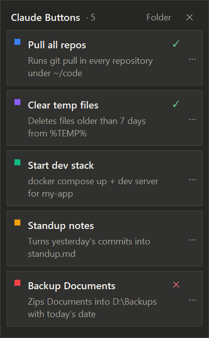

# Claude Buttons

[](https://github.com/pierrosimonestd-cpu/claude-buttons/actions/workflows/ci.yml)


[](LICENSE)

**A button bar for the Claude desktop app, filled by Claude itself.**

Ask Claude Code to *"make me a button that pulls all my repos"* and a button appears on a small bar docked to the edge of the Claude window. One click runs the script: no prompt, no tokens, no waiting.

<p align="center"></p>

- **Claude writes the automations.** An MCP server lets Claude create, test, edit and delete buttons from any Claude Code session.
- **Always one click away.** The bar docks to the right edge of the Claude desktop window in every project. Collapsed, it is a small tab; click it (or press `Ctrl+Alt+B`) to open it, click ✕ to close it.
- **Feels native.** It follows the Claude window as you move and resize it, hides when Claude is minimized, goes behind other apps together with Claude, and matches Claude's light/dark theme.
- **Scripts are plain files.** PowerShell, Python or batch, stored in `~/.claude-buttons/scripts`. Read them, edit them, keep them.

> Unofficial community project, not affiliated with or endorsed by Anthropic.

## Requirements

- Windows 10 or 11
- [Claude desktop](https://claude.ai/download) and the [Claude Code](https://code.claude.com/docs) CLI (`claude` on PATH)
- Python 3.10+ with tkinter (the default python.org installer includes it)

## Install

```powershell
git clone https://github.com/pierrosimonestd-cpu/claude-buttons.git
cd claude-buttons
powershell -ExecutionPolicy Bypass -File install.ps1
```

The installer:

1. installs the `mcp` Python package if it is missing;
2. registers the `claude-buttons` MCP server with Claude Code (user scope, so it works in every project);
3. adds a shortcut to your Startup folder so the bar starts with Windows (use `-NoStartup` to skip);
4. starts the bar.

The bar stays invisible until the Claude desktop window is open. If it is not running, the MCP server starts it when a Claude Code session begins.

## Usage

Open a **new** Claude Code session and ask for a button:

> make me a button that deletes files older than 7 days from my Downloads folder

Claude writes the script, can run it once to test it, and the button appears on the bar within a second.

| Action | How |
|---|---|
| Open / close the bar | Click the tab on the right edge of Claude, click ✕, or `Ctrl+Alt+B` |
| Run a button | Click it. ↻ while running, ✓ success, ✕ failure (the tab turns yellow while something runs) |
| Output, script, edit, delete | `⋯` or right-click on a button |
| Open the scripts folder | **Folder** in the bar header |

Scripts run without a console window and without interactive input, so parameters go in the script itself.

### Ideas

Things that make good buttons: anything you do more than twice a week and could describe in one sentence.

- *"Pull every git repo under C:\code and tell me which ones had changes"*
- *"Start my dev stack: docker compose up in my-app, then npm run dev"*
- *"Zip my Documents folder into D:\Backups with today's date"*
- *"Toggle what closing the laptop lid does between sleep and nothing"*
- *"Empty the Recycle Bin and delete temp files older than a week"*
- *"Open the three sites I check every morning"*

### MCP tools

| Tool | What it does |
|---|---|
| `add_button` | Create a button from a name, language, script, and optional description, working directory and color |
| `list_buttons` | List every button |
| `get_button` | Show a button's details and script |
| `update_button` | Change any field of a button |
| `remove_button` | Delete a button and its script |
| `run_button` | Run a button and return its exit code and output |

## Configuration

Settings live in `~/.claude-buttons/bar.json`:

```json
{
  "expanded": false,
  "dock_to": ["claude.exe"]
}
```

`dock_to` lists the executables the bar can dock to. For example, add `"WindowsTerminal.exe"` or `"Code.exe"` if you mostly use Claude Code in a terminal or in VS Code.

| Environment variable | Effect |
|---|---|
| `CLAUDE_BUTTONS_HOME` | Data folder (default `~/.claude-buttons`) |
| `CLAUDE_BUTTONS_NO_AUTOSTART` | Stop the MCP server from starting the bar |

## Security

Buttons run arbitrary scripts with your user permissions, exactly like running them yourself. They only run when you click them, or when Claude calls `run_button` (Claude Code asks for your permission first, unless you have allowed the tool). Review what Claude writes: `⋯ → View script`.

## Uninstall

```powershell
powershell -ExecutionPolicy Bypass -File uninstall.ps1               # keeps your buttons
powershell -ExecutionPolicy Bypass -File uninstall.ps1 -RemoveData   # deletes them too
```

## How it works

```
claude-buttons/
├── bar.pyw                 # starts the bar (pythonw, no console)
├── mcp_server.py           # starts the MCP server (registered with `claude mcp add`)
├── claude_buttons/
│   ├── registry.py         # data format, validation, script execution
│   ├── server.py           # MCP tools for Claude
│   ├── bar.py              # the bar UI (tkinter)
│   └── dock.py             # Win32: finds the Claude window, docking, DPI, hotkey, theme
├── tests/
├── install.ps1
└── uninstall.ps1
```

`registry.py` is the only module that touches `~/.claude-buttons`; the bar and the MCP server both go through it, and the bar picks up changes by watching the files.

The bar is an *owned window* of the Claude window: Windows keeps it just above Claude in the z-order and hides it with Claude, so it never floats over other apps.

Script output goes to a file rather than a pipe, so a button that launches a long-running program (a dev server, a tunnel) finishes as soon as its script does.

## Development

```powershell
python -m pip install -r requirements.txt pytest ruff
python -m pytest
python -m ruff check . ; python -m ruff format --check .
```

Issues and pull requests are welcome. See the [changelog](CHANGELOG.md) for what changed.

## License

[MIT](LICENSE)
